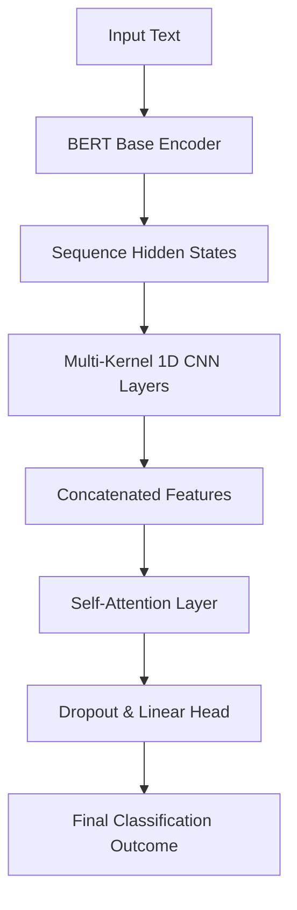

# Architecture Overview

The system implements a **Hybrid Neural Network Architecture** that synergizes three core components.

## 🏛 Structural Overview

## 🧩 Architectural Components

### 1. BERT (The "Brain")
- **Mechanism**: Bidirectional Encoder Representations from Transformers.
- **Function**: Extracts deep semantic contextual embeddings from the input message, understanding the *meaning* of words based on their placement in sentences.

### 2. 1D CNN (The "Pattern Recognizer")
- **Kernels**: Three parallel kernels of size `2`, `3`, and `4`.
- **Function**: Extracts local n-gram patterns and linguistic distress markers. It identifies specific phrasings related to psychological distress across varying phrase lengths.

### 3. Self-Attention (The "Prioritizer")
- **Function**: A custom attention mechanism that computes a weight for every segment of the CNN output. It teaches the model to "focus" on the most critical indicators within a long post while ignoring irrelevant noise.

### 4. Classification Head
- **Mechanism**: A fully connected layer with Dropout regularizers.
- **Function**: Maps the prioritized feature vector into a binary class space (Suicidal/Distressed vs. Non-Suicidal/Control).
